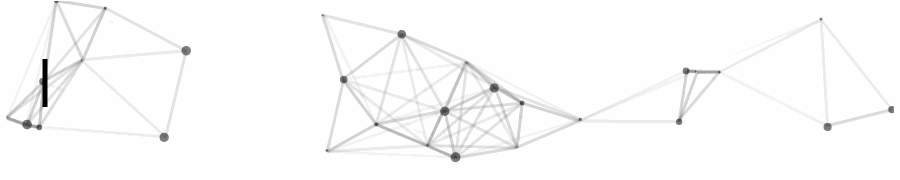

  

<h1 align="center">👋 Hi there! I'm Peter.</h1>
<h3 align="center">Digital Security Evangelist · Open Source Software Enthusiast</h3>

  
  
  

- :computer: You can find my professional profile on [LinkedIn](https://www.linkedin.com/in/pwilfahrt/)
- :rocket: You can find my most popular project on [dockerhub](https://hub.docker.com/r/wilfahrt/gatling-webserver)
- 🔭 I’m currently working on improving [digital security](https://www.digitale-sicherheit.org/)
- 👨‍🏫 Create a lasting impact with the [Cybersecurity Rotary Fellowship](https://www.cybersecurity-rotary-fellowship.org/)
- 🌱 I’m ~~currently~~ always learning new stuff
- :man_technologist: I'm crashing some maschines on [TryHackMe](https://tryhackme.com/p/pw1)
- 👯 I’m currently exploring and getting to know Github
- ⚡ Focus: building Federal Association Digital Security ([Github](https://github.com/Bundesverband-Digitale-Sicherheit-eV/), [Website](https://www.digitale-sicherheit.org))

You can find more about me and my projects on [my website](https://pw.is), [kiva.org](https://www.kiva.org/lender/peterw) or [instagram](https://www.instagram.com/peterwilfahrt/).

## Projects

<table align="center">
  <tr>
    <td align="center">
      <a href="https://www.digitale-sicherheit.org/" target="_blank">
        
         
        <b>Bundesverband Digitale Sicherheit e.V.</b>
      </a>
    </td>
    <td align="center">
      <a href="https://deutschlands-bester-hacker.de/" target="_blank">
        
         
        <b>Deutschlands Bester Hacker</b>
      </a>
    </td>
  </tr>
</table>

## Published Author

<table align="center">
  <tr>
    <td align="center">
      <a href="https://www.amazon.de/dp/B071HFVY7J?&tag=pwis09-21">
          
           
          <b>Cracking eCommerce for fun and profit</b>
      </a>
       
      Peter Wilfahrt
    </td>
    <td align="center">
      <a href="https://www.amazon.de/dp/1657204545?&tag=pwis09-21">
          
           
          <b>Chasing Digital Excellence</b>
      </a>
       
      Peter Wilfahrt
    </td>
    <td align="center">
      <a href="https://www.amazon.de/dp/1521135452?&tag=pwis09-21">
          
           
          <b>Cracking eCommerce for fun and profit</b>
      </a>
       
      Peter Wilfahrt
    </td>
  </tr>
</table>

## Articles on [pw.is](https://pw.is)

| Date | Article |
| ---- | ------- |
| 2026-11-08 | [Ein Token, der überall funktioniert: eine Mobilitäts-App im Test](https://pw.is/mobility-app-token-replay-disclosure/) |
| 2026-11-07 | [Reihenweise gemeldet: eine Runde Sicherheitsreviews in Open-Source-Software](https://pw.is/open-source-disclosure-runde/) |
| 2026-11-06 | [Schema.org per KI: strukturierte Daten automatisch erzeugen, in der EU oder auf eigener Hardware](https://pw.is/schema-org-per-ki/) |
| 2026-11-05 | [Die fünf Dimensionen des Brute-Force-Angriffs](https://pw.is/brute-force-dimensionen/) |
| 2026-11-04 | [Mobile Forensik verstehen: Was auf einem Smartphone steckt und wer es auslesen darf](https://pw.is/mobile-forensik-grundlagen/) |
| 2026-11-03 | [Cyberkriminalität ist ein Geschäftsrisiko, kein IT-Problem](https://pw.is/cybercrime-geschaeftsrisiko/) |
| 2026-11-03 | [Billige Domains sind der Grund, warum das Netz so unsicher ist](https://pw.is/billige-domains-dns-abuse/) |
| 2026-11-03 | [Die fünf Kunden, die deine Marge auffressen](https://pw.is/verhaltensbedrohungen-webshop/) |
| 2026-11-02 | [KI-Bots im Onlineshop: fast 1,8 Millionen Anfragen in einer Woche](https://pw.is/ki-bots-last-management/) |
| 2026-10-29 | [Die Ignoranz-Falle](https://pw.is/ignoranz-falle-loggen/) |
| 2026-10-22 | [Was EXIF-Daten in hochgeladenen Bildern verraten](https://pw.is/exif-daten/) |
| 2026-10-16 | [Wenn der Angreifer ein LLM ist](https://pw.is/angreifer-llm/) |
| 2026-10-14 | [Browser sind kompliziert, und das ist dein Vorteil](https://pw.is/bot-erkennung-ueber-verhalten/) |
| 2026-10-12 | [Prompt Injection: Was KMU aus 460.000 Angriffen lernen können](https://pw.is/prompt-injection-kmu/) |
| 2026-10-12 | [Warum IP-Adressen sperren dir nichts bringt](https://pw.is/ip-sperren-bringt-nichts/) |
| 2026-10-10 | [Interessenbestimmung](https://pw.is/interessenbestimmung/) |
| 2026-10-09 | [CISA-Warnung AA26-281A: Was KMU jetzt in Microsoft Defender prüfen sollten](https://pw.is/cisa-aa26-281a-defender-kmu/) |
| 2026-10-09 | [31 Millionen Deployments, und jetzt prüft eine KI meinen gatling-webserver](https://pw.is/gatling-webserver-oss-scanner/) |
| 2026-10-09 | [Vier Server, ein Hack und die Leute davor: was drei Wochen Forensik ergeben haben](https://pw.is/wordpress-hack-analysieren/) |
| 2026-10-08 | [Reverse Engineering als Haltung](https://pw.is/reverse-engineering-als-haltung/) |
| 2026-10-07 | [Warum ich meinen 1500-Tage-Streak abbreche](https://pw.is/streak-abbrechen-gamification/) |
| 2026-10-06 | [Kolibri-1, gpt-oss und Qwen auf dem NVIDIA GB10: ein Praxis-Benchmark](https://pw.is/kolibri-gb10-benchmark/) |
| 2026-10-01 | [Die Wissensbasis des Bundesverbands für digitale Sicherheit](https://pw.is/wissensbasis-bundesverband-digitale-sicherheit/) |
| 2026-10-01 | [Der coolste Typ in Bayreuth](https://pw.is/der-coolste-typ-in-bayreuth/) |
| 2026-09-29 | [Wie Du endlich richtige Logs erzeugst: NGINX Logs als JSON](https://pw.is/wie-du-endlich-richtige-logs-erzeugst-nginx-logs-als-json/) |

<small>&lt;!-- SYSTEM: HOST or HOSTNAME, USER or USERNAME, PASS or PASSWORD, DATABASE, CONTAINER, AUTH, AUTH_KEY, API_KEY, PWD, SHELL, and LANG --&gt;</small>
